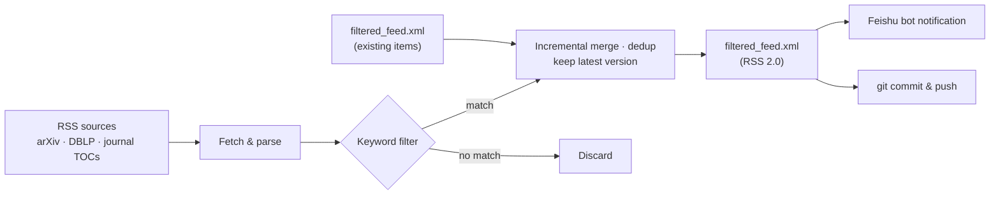

# 📰 Paper Feed

English | [简体中文](README.zh-CN.md)


> Automatically aggregates RSS updates from arXiv, DBLP conference streams and major journal TOCs, filters them by keywords into a single deduplicated feed, and pushes new-paper alerts to a Feishu (Lark) group. Runs on GitHub Actions every 6 hours.

## ✨ Features

- 🌐 **Multi-source aggregation** — arXiv categories, DBLP conference streams (volume pages expanded automatically), ScienceDirect / ACM journal TOCs, all in one config
- 🎯 **Flexible keyword rules** — `AND` combinations, phrase matching (tolerates hyphen/whitespace variants), word-boundary matching for acronyms (`RAG` won't match `stoRAGe`), `=` prefix for case-sensitive matching
- ♻️ **Incremental & deduplicated** — new entries are merged with existing ones by paper identity; for papers with multiple arXiv versions, the latest is kept
- 🏷️ **Source tagging** — titles are prefixed with `[ICSE 2026]`, `[arXiv-CR 2026]`, etc., so the origin is obvious at a glance
- 🔔 **Feishu notifications** — when new papers match, a webhook bot pushes them to a Feishu group
- 🤖 **Fully automated** — GitHub Actions fetches on schedule and commits & pushes the updated feed back to the repo

## 🔄 How It Works



## 📦 Project Structure

| File | Description |
| --- | --- |
| [get_RSS.py](get_RSS.py) | Main script: fetch, filter, merge, generate RSS, notify Feishu |
| [journals.dat](journals.dat) | RSS source list, one URL per line |
| [keywords.dat](keywords.dat) | Keyword rules, one per line |
| [filtered_feed.xml](filtered_feed.xml) | Generated RSS 2.0 feed |
| [requirements.txt](requirements.txt) | Python dependencies (feedparser, rfeed) |
| [.github/workflows/rss_action.yaml](.github/workflows/rss_action.yaml) | Scheduled workflow definition |

## 🔧 Configuration

### Adding RSS sources

Edit `journals.dat`, one RSS URL per line; lines starting with `#` are comments. The environment variable `RSS_JOURNALS` (newline or `;` separated) overrides the file.

### Keyword rules

Edit `keywords.dat`, one rule per line; an entry is included if any rule matches:

| Syntax | Matching rule | Example |
| --- | --- | --- |
| plain word | case-insensitive substring match over title + summary | `fuzzing` |
| ALL-CAPS acronym / token ≤ 5 chars | word-boundary match, plural `s` tolerated, avoids false hits | `RAG` matches `RAG`/`RAGs`, not `stoRAGe` |
| multi-word phrase | phrase match; `-` `_` `/` and whitespace interchangeable between words | `constraint solving` also matches `constraint-solving` |
| `A AND B` | every term must match | `LLM AND agent` |
| `=word` | case-sensitive exact matching | `=CodeQL` |

Example `keywords.dat`:

```text
# Program analysis
static analysis AND vulnerability
symbolic execution

# LLM related
LLM AND agent
large language model
```

### Environment variables

| Variable | Default | Description |
| --- | --- | --- |
| `RSS_JOURNALS` | — | RSS source list, takes precedence over `journals.dat` |
| `RSS_KEYWORDS` | — | Keyword list, takes precedence over `keywords.dat` |
| `RSS_OUTPUT_FILE` | `filtered_feed.xml` | Output file name |
| `RSS_MAX_ITEMS` | `1000` | Max items in the output feed |
| `RSS_JOURNALS_FILE` / `RSS_KEYWORDS_FILE` | `journals.dat` / `keywords.dat` | Config file paths |
| `RSS_FEISHU_WEBHOOK` | built-in | Feishu bot webhook; empty disables notifications |
| `RSS_NOTIFY_MAX_ITEMS` | `20` | Max items shown per notification |
| `RSS_DBLP_MAX_VOLUMES` | `1` | DBLP volume pages expanded per run |
| `RSS_DBLP_ENRICH_ARXIV` / `RSS_DBLP_ENRICH_MAX` | `0` / `30` | Toggle & limit for enriching DBLP entries with arXiv abstracts |
| `RSS_REQUEST_SLEEP_SEC` | `0.5` | Sleep seconds between extra requests (DBLP expansion, etc.) |
| `RSS_USER_AGENT` | Chrome UA | User-Agent used for fetching |

## 🖥️ Local Usage

```bash
pip install -r requirements.txt

# Regular: fetch increments + prune old items against current keywords
python get_RSS.py --prune-existing

# Only tweaked keywords, skip remote fetching
python get_RSS.py --skip-fetch --prune-existing

# Rebuild from scratch
python get_RSS.py --rebuild --prune-existing

# Enrich DBLP entries with arXiv abstracts (max 30 per run)
python get_RSS.py --prune-existing --dblp-enrich-arxiv
```

Run `python get_RSS.py --help` for all options.

## 🤖 GitHub Actions

- Runs automatically every 6 hours (cron `0 */6 * * *`), or manually from the [Actions](https://github.com/yx-yuu/paper-feed-private/actions) page
- After each run, the updated `filtered_feed.xml` is committed & pushed back to the repo

Manual dispatch supports these inputs:

| Input | Type | Default | Description |
| --- | --- | --- | --- |
| `rebuild` | boolean | `false` | Ignore existing XML and rebuild from scratch |
| `dblp_enrich_arxiv` | boolean | `false` | Fetch arXiv abstracts for DBLP entries |
| `dblp_enrich_max` | string | `30` | Max enrichments per run |
| `min_year` | string | `2022` | Only keep items published in or after this year |

## 📚 Covered Sources

Built-in source abbreviation mapping (selected):

- **Software engineering / PL / systems**: ICSE, FSE, ASE, ISSTA, OOPSLA, PLDI, POPL, SOSP, OSDI, FM
- **Security**: IEEE S&P, CCS, USENIX Security, NDSS, EuroS&P, RAID, ACSAC, TDSC, TIFS, C&S
- **AI / ML**: AAAI, NeurIPS, ICML, IJCAI, ACL
- **Journals**: TSE, TOSEM, TOPLAS, TSC, TOPS, CSUR, ESE, JSS, IST, SCP, SoftwareX, PACMPL, PACMSE
- **arXiv**: cs.CR, cs.SE, cs.PL, cs.AI, cs.LG, cs.CL, cs.IR, stat.ML

To add a source, append its URL to `journals.dat`; if you want an abbreviated title prefix, add a mapping entry in `JOURNAL_ABBR` / `DBLP_STREAM_ABBR` in `get_RSS.py`.

## 📡 Subscribe

Subscribe to the feed file in any RSS reader (raw URL):

```text
https://raw.githubusercontent.com/yx-yuu/paper-feed-private/main/filtered_feed.xml
```

> The raw URL of a private repo requires authentication — use a reader that supports custom request headers and configure a GitHub token.
