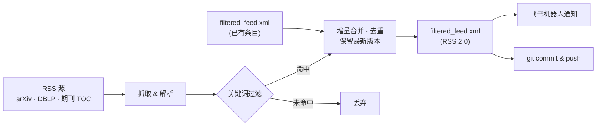

# 📰 Paper Feed


> 自动聚合 arXiv、DBLP 顶会流与主流期刊的 RSS 更新,按关键词过滤、去重合并为单一订阅源,并通过飞书机器人推送新论文提醒。GitHub Actions 每 6 小时自动运行。

## ✨ 特性

- 🌐 **多源聚合** — arXiv 分类、DBLP 会议流(自动展开 volume 页)、ScienceDirect / ACM 期刊 TOC,一处配置
- 🎯 **灵活的关键词规则** — 支持 `AND` 组合、短语匹配(容忍连字符/空白差异)、缩写词边界匹配(`RAG` 不会误命中 `stoRAGe`)、`=` 前缀精确大小写
- ♻️ **增量与去重** — 新抓取条目与已有条目按论文标识合并去重;arXiv 论文多版本自动保留最新
- 🏷️ **来源标注** — 标题自动加 `[ICSE 2026]`、`[arXiv-CR 2026]` 等前缀,一眼识别出处
- 🔔 **飞书通知** — 有新论文命中时,通过 webhook 机器人推送到飞书群
- 🤖 **全自动** — GitHub Actions 定时抓取,自动 commit & push 更新后的 feed 回仓库

## 🔄 工作流程



## 📦 项目结构

| 文件 | 说明 |
| --- | --- |
| [get_RSS.py](get_RSS.py) | 主脚本:抓取、过滤、合并、生成 RSS、飞书通知 |
| [journals.dat](journals.dat) | RSS 源列表,每行一个 URL |
| [keywords.dat](keywords.dat) | 关键词规则,每行一条 |
| [filtered_feed.xml](filtered_feed.xml) | 输出的 RSS 2.0 订阅源 |
| [requirements.txt](requirements.txt) | Python 依赖(feedparser、rfeed) |
| [.github/workflows/rss_action.yaml](.github/workflows/rss_action.yaml) | 定时任务定义 |

## 🔧 配置

### 添加 RSS 源

编辑 `journals.dat`,每行一个 RSS URL,`#` 开头为注释行。也可用环境变量 `RSS_JOURNALS`(换行或 `;` 分隔)覆盖文件配置。

### 关键词规则

编辑 `keywords.dat`,每行一条规则,任一条命中即收录:

| 写法 | 匹配规则 | 示例 |
| --- | --- | --- |
| 普通词 | 标题 + 摘要中子串匹配,不区分大小写 | `fuzzing` |
| 全大写缩写 / ≤5 字符短词 | 词边界匹配,兼容复数 `s`,避免误命中 | `RAG` 命中 `RAG`/`RAGs`,不命中 `stoRAGe` |
| 多词短语 | 短语匹配,词间允许 `-` `_` `/` 及空白等分隔 | `constraint solving` 也命中 `constraint-solving` |
| `A AND B` | 各词须同时命中 | `LLM AND agent` |
| `=词` | 区分大小写的精确匹配 | `=CodeQL` |

示例 `keywords.dat`:

```text
# 程序分析
static analysis AND vulnerability
symbolic execution

# LLM 相关
LLM AND agent
large language model
```

### 环境变量

| 变量 | 默认值 | 说明 |
| --- | --- | --- |
| `RSS_JOURNALS` | — | RSS 源列表,优先于 `journals.dat` |
| `RSS_KEYWORDS` | — | 关键词列表,优先于 `keywords.dat` |
| `RSS_OUTPUT_FILE` | `filtered_feed.xml` | 输出文件名 |
| `RSS_MAX_ITEMS` | `1000` | 输出 feed 最大条数 |
| `RSS_JOURNALS_FILE` / `RSS_KEYWORDS_FILE` | `journals.dat` / `keywords.dat` | 配置文件路径 |
| `RSS_FEISHU_WEBHOOK` | 代码内置 | 飞书机器人 webhook,留空则不通知 |
| `RSS_NOTIFY_MAX_ITEMS` | `20` | 单次通知最多展示条数 |
| `RSS_DBLP_MAX_VOLUMES` | `1` | DBLP 流每次运行展开的 volume 页数 |
| `RSS_DBLP_ENRICH_ARXIV` / `RSS_DBLP_ENRICH_MAX` | `0` / `30` | 为 DBLP 条目补全 arXiv 摘要的开关与上限 |
| `RSS_REQUEST_SLEEP_SEC` | `0.5` | 额外请求(DBLP 展开等)之间的间隔秒数 |
| `RSS_USER_AGENT` | Chrome UA | 抓取用的 User-Agent |

## 🖥️ 本地运行

```bash
pip install -r requirements.txt

# 常规:抓取增量 + 按当前关键词修剪旧条目
python get_RSS.py --prune-existing

# 只调整了关键词,不重新抓取
python get_RSS.py --skip-fetch --prune-existing

# 推倒重建
python get_RSS.py --rebuild --prune-existing

# 为 DBLP 会议条目补全 arXiv 摘要(每次最多 30 条)
python get_RSS.py --prune-existing --dblp-enrich-arxiv
```

`python get_RSS.py --help` 查看全部参数。

## 🤖 GitHub Actions

- 每 6 小时自动运行(cron `0 */6 * * *`),也可在 [Actions](https://github.com/yx-yuu/paper-feed-private/actions) 页面手动触发
- 运行结束后自动将更新后的 `filtered_feed.xml` commit & push 回仓库

手动触发支持以下输入:

| 输入 | 类型 | 默认值 | 说明 |
| --- | --- | --- | --- |
| `rebuild` | boolean | `false` | 忽略已有 XML,从头重建 |
| `dblp_enrich_arxiv` | boolean | `false` | 为 DBLP 条目抓取 arXiv 摘要 |
| `dblp_enrich_max` | string | `30` | 每次运行最多补全的条数 |
| `min_year` | string | `2022` | 仅保留该年份及之后发表的条目 |

## 📚 已覆盖的源

内置来源缩写映射(节选):

- **软件工程 / 编程语言 / 系统**:ICSE、FSE、ASE、ISSTA、OOPSLA、PLDI、POPL、SOSP、OSDI、FM
- **安全**:IEEE S&P、CCS、USENIX Security、NDSS、EuroS&P、RAID、ACSAC、TDSC、TIFS、C&S
- **AI / 机器学习**:AAAI、NeurIPS、ICML、IJCAI、ACL
- **期刊**:TSE、TOSEM、TOPLAS、TSC、TOPS、CSUR、ESE、JSS、IST、SCP、SoftwareX、PACMPL、PACMSE
- **arXiv**:cs.CR、cs.SE、cs.PL、cs.AI、cs.LG、cs.CL、cs.IR、stat.ML

新增来源只需在 `journals.dat` 加一行 URL;若希望标题前缀使用缩写,在 `get_RSS.py` 的 `JOURNAL_ABBR` / `DBLP_STREAM_ABBR` 中补一条映射即可。

## 📡 订阅

在任意 RSS 阅读器中订阅仓库中的 feed 文件(raw 地址):

```text
https://raw.githubusercontent.com/yx-yuu/paper-feed-private/main/filtered_feed.xml
```

> 私有仓库的 raw 地址需要鉴权,请使用支持自定义请求头的阅读器并配置 GitHub token。
